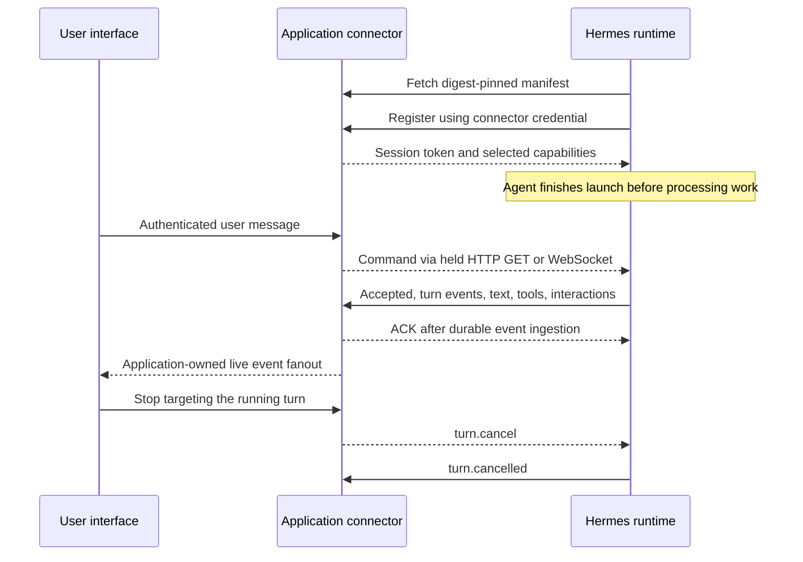

# Ritual Agent Link: application integration reference

This guide describes `ritual.agent-link/1` and `ritual.agent-connector/1` for applications connecting to persistent Hermes agents. It specifies the application-visible behavior and both supported transports. Check the connected runtime's registration capabilities before enabling a feature.

You need a Ritual RPC and supported executor deployment for persistent-agent launch, the launch configuration described in the [persistent-agent skill](../../ritual-dapp-agents/SKILL.md), and an application backend that can serve HTTPS and optionally WebSocket. No private source checkout or access inside an executor is required. All application names, domains, routes, and user IDs below are illustrative placeholders.

Contents: [ownership](#ownership-and-data-flow), [launch](#launch-and-wake-configuration), [manifest](#connector-manifest), [registration](#registration-and-capabilities), [HTTP](#http-transport), [WebSocket](#websocket-transport), [commands](#command-envelope-and-controls), [events](#events-and-ui-state), [recovery](#delivery-reconnect-and-recovery), [verification](#verification-and-troubleshooting), [compatibility](#compatibility-and-support).

## Ownership and data flow

| Component | Responsibility |
|---|---|
| Browser/application client | Authenticate the human, submit application actions, render streamed events, request cancellation/approval responses |
| Application backend/connector | Host the pinned manifest and connector endpoints; authorize users and agent registration; persist commands/events; manage sessions, cursors, ACKs, and browser fanout |
| Agent runtime | Connect outbound, validate and deduplicate commands, execute turns, and publish output, tool, interaction, and lifecycle events |
| Ritual network and executor service | Launch the persistent agent, report launch outcome, and maintain its liveness and recovery lifecycle |



All connector connections originate at Hermes. There is no requirement to expose a public listening port in the agent container. Browser-to-backend routes and SSE/WebSocket fanout are application choices, separate from the Hermes-to-connector transport.

“Full duplex” means the application can send controls while output and tool activity are arriving. WebSocket does this on one connection; HTTP uses concurrent command and event channels. It does not imply that every Hermes endpoint, internal tool result, media mode, or provider token is exposed.

The chain's asynchronous `0x0820` launch/settlement and heartbeat/revival remain separate from the application command/event loop. RITHTTP1 request/result streaming belongs to another protocol; its docs do not specify Agent Link.

## Launch and wake configuration

Select persistent `agent_runtime = 2` (Hermes). This is the persistent-runtime selector, not the sovereign CLI enum. Include the following in the runtime configuration carried by the legacy-named `openclaw_config_ref`. This fragment supplements the direct consumer launch, explicit remote DA, funding, and heartbeat configuration.

```json
{
  "uahi": {
    "enabled": true,
    "mode": "events",
    "onboard_mode": "off",
    "application_ref": {
      "app_id": "my-app",
      "manifest_url": "https://app.example.com/agent-connector.json",
      "manifest_sha256": "REPLACE_WITH_SHA256_OF_EXACT_SERVED_BYTES",
      "credential_ref": "APP_CONNECTOR_TOKEN"
    },
    "authorization": {
      "allow_all_users": false,
      "allowed_users": ["user-123"]
    }
  }
}
```

Tool approval policy is independent of wake mode. Add
`"hermes": {"approvals": {"mode": "off"}}` alongside `uahi` for a launch that
bypasses tool approval prompts, or choose `smart` / `manual`. Omission retains
Hermes' native `smart` default; Agent House explicitly selects `off` for new
launches. See [Hermes tool approval policy](../../ritual-dapp-agents/SKILL.md#hermes-tool-approval-policy)
for the required runtime rollout, recovery behavior, and exact scope. Continue
handling clarification interactions even with tool approvals off.

The digest placeholder must become a real 64-character hex SHA-256. Hash the exact response bytes, not a parsed/reformatted JSON object. Publish stable manifest bytes before launching. A changed manifest requires a corresponding trusted pin update; a mutable URL alone is not sufficient.

| UAHI mode | External work commands | Timer inference | Behavior |
|---|---|---|---|
| `events` (`reactive` alias) | Enabled | Disabled | Agent Link |
| `cadence` | Disabled | Enabled | Agent Link |
| `hybrid` | Enabled | Enabled | Agent Link |
| `autonomous` | Uses the autonomous work configuration | Autonomous work loop | Separate from the event-driven connector |
| `off` or disabled UAHI | No UAHI work source | No UAHI work source | Other configured platforms may still work |

In cadence mode, control commands remain available even though external `conversation.message` and `application.event` inference triggers are disabled. Set `uahi.wake.cadence` for timer behavior: `every_ms` (1,000–86,400,000; default 60,000), `overlap` (`skip` or `coalesce`; default `coalesce`), `thread_id` (default `cadence`), and `prompt` (1–4,000 characters). The enabled wake sources are selected by `mode`; changing a nested enabled flag alone does not select the mode.

For event-only cognition, use `events`, disable autonomous work, and check other configured platforms/cron jobs separately. On-chain liveness heartbeat and transport polling do not themselves run inference. An omitted mode can select legacy autonomous behavior; configure it explicitly.

Fresh-launch connector credential reference names must match `APP_CONNECTOR_[A-Z0-9_]{1,111}`. Put the actual bearer value in the [encrypted launch secrets](../../ritual-dapp-secrets/SKILL.md) under that name; the runtime configuration contains only its reference. Issue a credential scoped to the intended application and agent. The agent uses it to register with your backend, including after session loss. Keep that credential valid for the agent's intended lifetime and recovery policy.

Use the runtime configuration above with the [persistent-agent launch workflow](../../ritual-dapp-agents/SKILL.md). You do not need a traffic generator or an internal launch CLI. Configure recovery storage through the [DA skill](../../ritual-dapp-da/SKILL.md).

Registration can precede completion of the agent's launch. Treat a registered session as a connected transport, not proof that work can begin. Confirm launch success through the launch workflow, then submit a bounded test message and observe `turn.started` and a terminal event. If startup stalls, retain the launch identifier and connector observations for the deployment operator; checking files inside the runtime is unnecessary.

Validate the actual assistant response and tool result as well as terminal events. A provider credit error can be rendered as completed assistant text, so `turn.completed` alone does not prove successful model execution.

Production manifests and transport bases use HTTPS; WebSocket is derived as WSS. Insecure HTTP is an explicit local-development exception restricted to loopback or eligible literal private IPs in local-dev mode. URL validation prevents credentials in URLs, escaping the configured transport origin, and unsafe destinations.

For local deployments, check that a public HTTPS hostname resolves publicly from the runtime's network. A tailnet hostname can resolve to a private address there even when public forwarding is enabled; use a publicly resolving application endpoint for the public-URL flow.

## Connector manifest

The application serves the manifest without relying on a connector bearer header: the runtime manifest GET does not send one. Credentials belong in registration, not the manifest.

HTTP example; these routes are illustrative application-owned names:

```json
{
  "spec_version": "ritual.agent-connector/1",
  "app_id": "my-app",
  "transport": {
    "kind": "long_poll",
    "base_url": "https://app.example.com",
    "register_path": "/chain/agents",
    "commands_path": "/chain/agents/{session_id}/commands",
    "events_path": "/chain/agents/{session_id}/events",
    "long_poll_wait_ms": 25000
  },
  "wake_event_types": ["user.message", "application.request"]
}
```

For WebSocket, replace the transport object with:

```json
{
  "kind": "websocket",
  "base_url": "https://app.example.com",
  "register_path": "/chain/agents",
  "websocket_path": "/chain/agents/{session_id}/socket"
}
```

Keep an HTTPS base even for WebSocket; the bridge converts the resolved socket URL to WSS. Paths are origin-relative templates and session IDs are escaped. One manifest selects one transport; it does not negotiate an automatic HTTP fallback from WebSocket.

`wake_event_types` filters `application.event.data.subtype`; it is not an event-output subscription. `event_subscription`, when present, is a list of emitted event types the app wants. Omission requests all supported events. Mandatory lifecycle/output/error events are added even when omitted from the subscription.

Default manifest bound is 256 KiB; runtime frame/response bound is 1 MiB. Long-poll wait accepts 100–120,000 ms. Default work-command text bound is 20,000 characters. Deployments and intermediaries may impose tighter limits; handle explicit rejection without silently truncating commands.

## Registration and capabilities

Both transports begin with HTTP `POST register_path` using `Authorization: Bearer <connector-token>`:

```json
{
  "spec_version": "ritual.agent-connector/1",
  "protocol_version": "ritual.agent-link/1",
  "app_id": "my-app",
  "agent_id": "agent-123",
  "agent_address": "<runtime-address>",
  "command_cursor": null,
  "event_ack": 0,
  "capabilities": {
    "protocol_versions": ["ritual.agent-link/1"],
    "runtime": {"name": "hermes"},
    "transports": ["long_poll"],
    "accepts": {"conversation.message": [1], "turn.cancel": [1], "interaction.respond": [1], "session.reset": [1], "application.event": [1]},
    "emits": {},
    "features": {"durable_replay": true, "transient_snapshots": true, "binary_frames": false, "max_in_flight_turns_per_thread": 1, "reasoning_summaries": false, "tool_argument_detail": "keys"}
  }
}
```

The example abbreviates `emits`; the runtime supplies the full event/version map listed below. For WebSocket it advertises `transports: ["websocket"]`. Read this actual capability document at registration; do not manufacture assumptions based on the name Hermes.

Application response:

```json
{
  "protocol_version": "ritual.agent-link/1",
  "session_id": "session-123",
  "session_token": "<new-session-bearer>",
  "event_ack": 0
}
```

`session_id` and a nonempty `session_token` are required. `command_cursor`, `event_ack`, and `effective_subscription` may be returned. Return only a cursor consistent with the app's durable command delivery state and an ACK justified by durable event storage. Connector tokens authenticate registration; subsequent polling, event POSTs, and WebSocket upgrades use the session bearer. Registration always returns to the durable connector credential after session loss.

The backend must bind the credential to the intended app/agent and authorize browser users separately. An `agent_id` in a request body is not independent cryptographic proof. Likewise, actor IDs must be derived from authenticated application users, not trusted from arbitrary browser JSON.

## HTTP transport

| Direction | Request | Response/meaning |
|---|---|---|
| Hermes → application | `GET commands_path?wait_ms=25000&cursor=<opaque>` with session bearer | Hold until commands are available or the wait expires |
| Application → Hermes | `200` JSON with `commands` and optional `cursor` | Ordered command delivery; Hermes processes commands then stores the returned cursor |
| Application → Hermes | `204` | No command; no inference |
| Hermes → application | `POST events_path` with session bearer and `Idempotency-Key: batch_<digest>` | Deliver event batch while command polling continues |
| Application → Hermes | JSON `{"ack_sequence": <highest-sequence-in-batch>}` | Entire received batch durably accepted |

Command response:

```json
{"protocol_version":"ritual.agent-link/1","cursor":"cursor-42","commands":[]}
```

Use real command envelopes in `commands` when work exists. The cursor is opaque and bounded to 1,024 characters. Preserve delivery order and tolerate repeat polls after ambiguous disconnects. The bridge uses a poll timeout of wait duration plus 10 seconds; configure proxy request timeouts accordingly.

Event request:

```json
{"protocol_version":"ritual.agent-link/1","batch_id":"batch_<digest>","events":[]}
```

Real batches contain event envelopes. The batch ID is derived from their ordered immutable IDs and remains stable across retries. ACK exactly the highest sequence in that received batch; a partial, missing, or future ACK fails delivery. A `401` on polling or event submission triggers registration with the connector credential. Event submission retries using the refreshed session.

## WebSocket transport

After HTTP registration, Hermes opens the manifest-selected socket with the session bearer in the upgrade headers. It sends text JSON frames; binary frames are unsupported. Compression is disabled. Current connection settings include 30-second pings, 60-second ping timeout, and a 10-second wait for the first server frame.

Handshake, Hermes → application:

```json
{"type":"resume","protocol_version":"ritual.agent-link/1","session_id":"session-123","command_cursor":"cursor-42","event_ack":17,"capabilities":{}}
```

`capabilities` here is abbreviated; Hermes sends the same full document described above. Application → Hermes, first frame:

```json
{"type":"ready","protocol_version":"ritual.agent-link/1","session_id":"session-123","event_ack":17}
```

The selected protocol and session must match; duplicate `ready` or commands before `ready` are protocol errors. An optional `effective_subscription` narrows optional events while preserving mandatory ones.

Application → Hermes command frame:

```json
{"type":"command","cursor":"cursor-43","command":{"protocol_version":"ritual.agent-link/1","kind":"command","id":"cmd-43","sequence":43,"type":"conversation.message","type_version":1,"scope":{"thread_id":"thread-1"},"data":{"actor":{"id":"user-123"},"content":[{"kind":"text","text":"Hello"}]}}}
```

Hermes → application command receipt:

```json
{"type":"ack","direction":"commands","sequence":43,"cursor":"cursor-43"}
```

This transport ACK does not prove inference succeeded. Observe `command.accepted`/`command.rejected` and the turn's terminal event.

Hermes → application event batch:

```json
{"type":"events","protocol_version":"ritual.agent-link/1","batch_id":"batch_<digest>","events":[]}
```

Application → Hermes after durably storing the real batch:

```json
{"type":"ack","direction":"events","batch_id":"batch_<digest>","sequence":18}
```

The ACK must name the outstanding batch and its highest sequence; the current sender waits up to 30 seconds. Unknown batch IDs or malformed frames fail the connection. The app may report `{"type":"protocol_error","code":"...","message":"..."}`. Wire failures reconnect with bounded exponential delay (up to 30 seconds between attempts); an expired session causes re-registration. A transport reconnect does not itself prove that an interrupted agent turn has resumed.

## Command envelope and controls

All commands have `protocol_version`, `kind: "command"`, nonempty `id` (up to 256 characters), positive integer `sequence`, `type`, integer `type_version: 1`, `scope.thread_id`, and object `data`. A supplied `scope.session_id` or `scope.agent_id` must match. Thread/actor/session-style IDs use `[A-Za-z0-9][A-Za-z0-9._:-]{0,255}`. Optional `occurred_at` for work commands is ISO-8601.

All five commands require an authorized `data.actor.id`. `chat_type` defaults to `dm` and accepts `dm`, `group`, or `channel`. The backend should supply the minimum intended scope and validate it independently.

| Type | Required command-specific data | Result |
|---|---|---|
| `conversation.message` | `content: [{"kind":"text","text":"..."}]` | Normal Hermes work turn; only nonempty text parts currently accepted |
| `application.event` | Eligible `subtype` and `payload: {"text":"..."}` | Normal Hermes work turn from application event |
| `turn.cancel` | `turn_id` of a queued/running turn in the same thread | Cancels the targeted queued or running turn; observe its terminal event |
| `interaction.respond` | `interaction_id`, matching `turn_id`, and object `response` | Resolve the pending clarification/approval |
| `session.reset` | No additional required data | Reset the conversation and emit `session.reset` |

Actor data applies to every row even where not repeated. Clarification response is `{"text":"answer"}` or `{"selected":"choice"}`. Approval response is `{"action":"once"}`, `session`, `always`, or `deny`, restricted to the actions actually offered; `approve` normalizes to `once`. The interaction's actor, turn, thread, and chat type must match. Pending interactions can expire or become unavailable after recovery; an old UI prompt is not continuing authorization after recovery.

Stop example data: `{"actor":{"id":"user-123"},"turn_id":"turn_<id-from-events>"}`. Learn the runtime-generated turn ID from events; do not derive it from command ID. Keep running and queued turns separate in the UI. Selecting the newest nonterminal turn can cancel queued work while an older turn keeps running. Cancellation is not rollback of side effects already performed.

Normal follow-ups obey Hermes' configured busy-message policy (`interrupt`, `queue`, or `steer`). These are runtime conversation policies, not additional Agent Link command types or a documented per-message mode selector. In queue mode the bridge preserves commands as distinct turns. Use `turn.cancel` for explicit targeted cancellation and observe the target turn's terminal state.

## Events and UI state

Events use the common envelope:

```json
{
  "protocol_version": "ritual.agent-link/1",
  "kind": "event",
  "id": "evt-example",
  "sequence": 18,
  "type": "assistant.output.delta",
  "type_version": 1,
  "occurred_at": "2026-09-22T12:00:00+00:00",
  "critical": false,
  "delivery": "transient",
  "scope": {"agent_id":"agent-123","session_id":"session-123","thread_id":"thread-1","turn_id":"turn-example"},
  "correlation": {"command_id":"cmd-43"},
  "visibility": "user",
  "data": {"stream_id":"out-example","index":1,"text":"Hello"},
  "extensions": {}
}
```

All currently advertised event types are version 1:

| Family | Event types | UI/consumer meaning |
|---|---|---|
| Command | `command.accepted`, `command.rejected` | Submission disposition; acceptance is not completion |
| Turn | `turn.queued`, `turn.started`, `turn.status`, `turn.completed`, `turn.failed`, `turn.cancelled`, `turn.indeterminate` | Distinguish queue, execution, progress, and terminal outcome |
| Assistant output | `assistant.output.started`, `.delta`, `.snapshot`, `.completed` | Build text by stream ID and index; replace from snapshot/completed text |
| Commentary | `assistant.commentary` | User-facing intermediate commentary separate from final output |
| Tools | `tool.call.started`, `tool.call.completed`, `tool.call.failed` | Correlate by call ID and show tool activity |
| Interaction | `interaction.requested`, `interaction.resolved`, `interaction.expired` | Show/resolve/remove clarification and approval controls |
| Session | `session.reset` | Conversation reset event |
| Runtime | `runtime.status`, `runtime.warning`, `runtime.error` | Operational information, warnings, errors |

The full assistant type names all begin `assistant.output.`. This is the advertised vocabulary; a capability being supported does not mean every turn emits it.

Mandatory subscription events: `command.accepted`, `command.rejected`, `turn.started`, `turn.completed`, `turn.failed`, `turn.cancelled`, `turn.indeterminate`, `assistant.output.completed`, `runtime.error`.

Durable defaults include command disposition, turn queue/start/terminal events, output start/snapshot/completion, commentary, tool lifecycle, interactions, session reset, and runtime warning/error. Deltas, turn status, and runtime status are transient by default. Honor the envelope's actual `delivery` and `visibility` fields.

Output deltas carry `stream_id`, `index`, and incremental `text`. Snapshot/completed events carry the full text at their index. Replace the accumulated text on snapshot/completion; appending it duplicates output. Transient loss can leave sequence gaps, so a gap is not automatically evidence of missing durable events. Deduplicate durable envelopes by event ID within the authenticated agent/link history. Render completion even if no deltas were observed.

Tool start includes `call_id`, `name`, and `argument_keys`; completion/failure includes `call_id`, `name`, `duration_ms`, and `result_kind`. These base fields remain useful without execution payloads. When registration advertises `features.tool_execution_payloads.schema_version: 1`, tool events can additionally contain `data.execution` with `schema_version: 1`, an `arguments` record, and a `result` record on completion. Each record carries `encoding`, `value`, `truncated`, and `withheld`; preserve these flags and handle omitted/withheld values instead of assuming a complete tool transcript. Current registrations can advertise a `max_value_chars` bound, `redacted: true`, and `live_output_chunks: false`. The base `tool_argument_detail: "keys"` field does not disable this separately advertised extension. Feature availability must be checked against the connected runtime.

Reasoning summaries and binary frames are explicitly unsupported. Approval events can contain a command for the authorized approver and use developer visibility; do not treat visibility as a substitute for backend authorization.

Do not make output completion the sole turn-status signal: tool, cancellation, failure, and interaction state have their own events. Scope UI updates by agent/thread/turn/stream and correlate them to `correlation.command_id`.

## Delivery, reconnect, and recovery

The protocol supports durable command deduplication and event replay. Retried command IDs must keep the same payload; altered payloads produce `idempotency_conflict`. Reusing a sequence for another command produces `sequence_conflict`. Allocate positive command sequences across the link's command history, not independently per thread or new HTTP session. Keep identity stable across network retries; a new ID means a new action.

For replay across renewed sessions, preserve the original command payload. Embedding an ephemeral `scope.session_id` ties that payload to the old session. A backend design can omit that optional field and enforce current session identity through authenticated transport while retaining agent/thread scope. Do not rewrite an already reserved command under its old ID.

The application owns durable command storage and event ingestion. Store the event batch transactionally before returning its ACK; on repeated event IDs or batch IDs, return the same safe cumulative acknowledgement without duplicating user-visible effects. ACK is a high-water mark, not an inference receipt. Registration/resume ACKs may not exceed the runtime's emitted high-water mark.

Unacknowledged durable events replay after reconnect. Keep event ingestion idempotent even after reconnecting under a new session. Transient delivery is best-effort: congestion or disconnects may discard deltas, while durable output snapshots/completion allow the application to reconstruct the final text. Accept batched events without relying on a fixed batch size or flush interval.

After runtime recovery, previously accepted, queued, or running work may be reported as `turn.indeterminate` rather than automatically executed again. A socket reconnect to an otherwise healthy runtime can preserve ongoing work. Present an explicit retry decision after an indeterminate turn, especially when tools may have caused side effects.

DA restore is eventually consistent: only the last verified recovery point is guaranteed, and newer conversation/workspace updates may be lost. Protocol deduplication is not a guarantee of exactly-once external side effects across crashes and DA rollback. Make consequential application operations independently idempotent and reconcile their actual outcome before retrying.

Workspace instructions define the agent's identity and standing behavior. Supply them through the documented launch configuration and use messages or application events for new work. Recovery restores a prior saved state; do not assume changing an old launch input updates a running or recovered agent. Workspace prose does not replace transport authorization, wake-mode selection, or protocol controls.

## Verification and troubleshooting

Use this acceptance checklist against your backend and a test agent on the target deployment. Inspect your own connector requests, stored events, and user-visible results:

1. Record the launch identifier and registration capabilities. Fetch the served manifest bytes and verify the SHA-256. Confirm the required protocol, transport, command versions, and events are advertised.
2. Confirm the launch succeeds, then send a bounded message and observe its turn lifecycle. Registration and a connected socket alone are insufficient.
3. In event-only mode with other triggers disabled, verify idle polls, `204` responses, pings, and on-chain heartbeat do not produce new turns or output. If model usage is exposed by your provider, check that too; a quiet event stream alone does not prove zero provider calls.
4. Submit an authenticated message and observe acceptance, the correct turn/thread, output and a terminal outcome over each transport you intend to support.
5. Retry an identical command and an already stored event batch; verify no duplicate inference or UI effects. Reject changed payloads under reused IDs.
6. Disconnect during output; reconnect with cursor/ACK, replay durable tail, and rebuild final text from snapshot/completion. Expire a session and verify connector-authenticated re-registration.
7. Queue a second turn, cancel the queued turn, then separately cancel a running turn. Verify the chosen target and terminal event.
8. Resolve clarification and approval requests; reject wrong actor/thread/turn and expired interaction IDs.
9. If your deployment offers a supported restart/recovery test, exercise it on a test agent and handle `turn.indeterminate`. Otherwise test that event using a connector fixture and record runtime recovery as unverified. Reconcile any tool-side effect before explicit retry.
10. Test wrong manifest digest, unsupported protocol/version, binary frames, mismatched session, invalid batch ACK, denied actor, and disabled wake triggers.

| Symptom | Check first |
|---|---|
| Registers but does not process commands | Launch outcome; `uahi.mode`; authorization; session/protocol compatibility |
| No idle inference expected but model calls occur | Autonomous work, cadence/hybrid mode, other platforms, cron/scheduled tasks |
| HTTP works but socket does not | Manifest kind/path, HTTPS-to-WSS derivation, upgrade bearer support, first `ready` frame, session identity |
| Events repeat indefinitely | Durable ingest transaction, exact highest-sequence ACK, matching WebSocket batch ID, session expiry |
| Stop appears ineffective | Target is queued instead of running; wrong thread; already terminal turn; outstanding external side effect |
| Partial/duplicated text after reconnect | Snapshot appended instead of replaced; missing event deduplication; dropped transient deltas |
| Revival loses current prompts or authority | Documented recovery guarantees, saved application state, credential validity, and observed registration errors |

## Compatibility and support

This reference is self-contained for the Agent Link application protocol. The related [persistent-agent](../../ritual-dapp-agents/SKILL.md), [secrets](../../ritual-dapp-secrets/SKILL.md), and [DA](../../ritual-dapp-da/SKILL.md) skills describe the supporting launch inputs. You do not need executor, execution-client, or runtime source code to follow these steps.

Registration advertises accepted commands, emitted events, versions, transports, and feature limits. Only enable supported features. Reject unsupported protocol selections explicitly and report a useful compatibility error to the application operator. Do not assume upstream Hermes features are available through Agent Link unless the connected runtime advertises them.

When requesting deployment support, provide the launch identifier, protocol/capability document, transport kind, relevant command/event IDs, timestamps, and sanitized HTTP status or protocol error. Exclude connector/session tokens and encrypted-launch secret values. These observations allow a deployment operator to investigate without requiring the application developer to inspect internal services.
